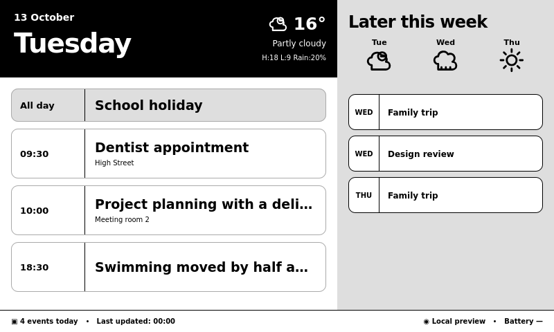

# TRMNL Paper Calendar

An 800 × 480 Liquid calendar for TRMNL OG displays, ported from [Paper Calendar](https://github.com/simondoescode/paper-calendar/blob/main/src/calendar/calendar_renderer.cpp). The local development dashboard renders **the production `src/full.liquid` through trmnlp**, with ICS and weather data. No Terminus server, TRMNL account or hardware is needed.



## Quick start

Install Docker Desktop with Compose **2.24 or newer**. On Windows 11, use Linux containers and enable WSL2 integration for Ubuntu. From PowerShell in the repository, or an Ubuntu WSL2 terminal:

```sh
docker compose up --build
```

Open **http://localhost:8080**. Defaults are two offline fixture calendars, mock weather and **13 October 2026**, matching the fixtures. HTTP ports bind to `127.0.0.1`; a separate Terminus server on port 2300 is unaffected. The first build downloads images, Python packages and official TRMNL Framework CSS/fonts. Once built, mock previews need no internet.

Choose calendar **mock/live**, weather **mock/live/disabled**, a preview date and a scenario. Changing controls refreshes data. **Refresh data** fetches and parses sources again. **Reload preview** renders the latest context and current Liquid without refetching. Edit `src/full.liquid`, then reload without restarting Docker. Fixtures and local calendar configuration are read on refresh. Python code changes require `docker compose restart preview`; dependency or renderer adapter changes require a rebuild.

The iframe is always 800 × 480. **Scale to fit** changes its displayed size; turn it off for full size. **Four-shade simulation** quantizes the view to four greys. Physical panel fidelity has not been validated.

## Fixtures and simulated dates

Family and Work cover all-day events, a multi-day trip, overlapping appointments, long titles, weekly recurrence, EXDATE, RDATE, a moved RECURRENCE-ID instance and travel crossing midnight. Use 13–16 October 2026. Empty calendars exercise the empty state. DST scenarios automatically select 29 March or 25 October 2026; autumn includes both occurrences of 01:30 and a weekly appointment across the clock change.

ICS dates remain fixed when the preview date changes, so recurrence and continuation are visible. Mock weather follows the chosen date. Calendar conversions use **Europe/London** and UK date formatting.

## Private live calendars

Copy examples in PowerShell:

```powershell
Copy-Item .env.example .env
Copy-Item dev_preview/calendars.example.json calendars.local.json
```

Or Ubuntu WSL2:

```sh
cp .env.example .env
cp dev_preview/calendars.example.json calendars.local.json
```

Edit the ignored `.env` locally. Set `FAMILY_CALENDAR_URL` and/or `WORK_CALENDAR_URL` to private HTTPS ICS subscription URLs. These URLs are credentials; never commit them. The ignored `calendars.local.json` references environment names:

```json
{
  "calendars": [
    {"name": "Family", "url_env": "FAMILY_CALENDAR_URL", "enabled": true},
    {"name": "Work", "url_env": "WORK_CALENDAR_URL", "enabled": false}
  ]
}
```

Up to ten calendars are supported. Additional variable names must end in `_CALENDAR_URL`; add them to `.env` and reference them in JSON. After changing `.env`, run `docker compose up -d --force-recreate preview`. Changes to JSON need only **Refresh data**. Select **live** and a date containing events. One failed source does not block other calendars.

Fetching allows public HTTPS destinations on port 443 only. DNS answers must all be public; connections pin a validated IP while preserving hostname TLS verification. Redirects and environment proxies are disabled. Connect/read timeouts are 5/12 seconds, decompressed responses are limited to 2 MB. Parsing runs in a disposable process with five wall-clock seconds, three CPU seconds and 256 MB memory. Each source is limited to 500 definitions, occurrences or display segments; combined data must fit trmnlp's 100 KB contract. Oversized calendars are rejected, not silently truncated.

Private URLs never appear in generated context files, API results or diagnostics. Upstream exceptions become generic source statuses; diagnostics identify sources by ordinal. Calendar names and event content remain visible locally, so avoid sharing live-data screenshots. Keep the default loopback binding.

## Weather

**Mock** uses deterministic fixtures; **disabled** displays Weather unavailable. For **live**, configure `.env`:

```dotenv
WEATHER_LATITUDE=51.11
WEATHER_LONGITUDE=-0.19
WEATHER_UNITS=celsius
```

These are example coordinates, not hard-coded defaults. Both coordinates are required; units support `celsius` or `fahrenheit`. Recreate the preview service after environment changes, select **live**, then refresh. [Open-Meteo](https://open-meteo.com/en/docs) supplies current temperature/condition, daily highs/lows, precipitation probability and three forecasts. WMO codes map to stable identifiers for the existing SVG icons. No API key is needed.

Successful live weather stays cached in memory after failures. Diagnostics show its last successful timestamp and stale status. Refresh always retries. **Live weather follows actual API dates even when the calendar is simulated**; historical weather is not implemented. Mock weather and its footer timestamp are deterministic; diagnostics show actual refresh time.

## Tests and diagnostics

```sh
docker compose run --rm --no-deps preview python -m unittest -v
docker compose run --rm trmnlp lint
docker compose exec renderer ruby /plugin/dev_preview/browser_test.rb
```

Start the stack before browser tests. They use Firefox/Selenium already bundled in trmnlp, verify layout/data/states/controls/local assets and compare repeated deterministic screenshots. Screenshots are stored at `/tmp/screenshots` in the renderer:

```sh
docker compose cp renderer:/tmp/screenshots ./dev_preview/artifacts
```

CI builds images, runs offline tests and lint, checks browser rendering and uploads screenshots. Builds need network; tests need neither private credentials nor external data APIs. The mock screenshot is compared with the committed `docs/mock-preview.png` baseline and a repeated capture. On intended visual changes, inspect the new artifact before updating the baseline with `docker compose cp renderer:/tmp/screenshots/mock-preview.png docs/mock-preview.png`. Browser/framework upgrades may require a reviewed baseline update.

The dashboard shows display-segment count (multi-day events contribute multiple segments), source status, weather status, last successful refresh, weather timestamp and warnings. For startup/rendering errors:

```sh
docker compose ps
docker compose logs --tail 100 preview renderer
```

If 8080 is occupied, change its host port in `compose.yaml`. Missing feeds/coordinates produce generic diagnostics. Empty dates outside fixture coverage are expected. Native Liquid syntax errors appear in the preview. This full-screen-only plugin has documented lint exceptions for unsupported mashup layouts and required Terminus inline wrappers in `.trmnlp.yml`.

Stop with Ctrl+C, or `docker compose down` after using `-d`. Reset context/cache with `docker compose restart preview` and reopen the dashboard. To discard private configuration, delete `.env` and `calendars.local.json` yourself and recreate the service. The preview creates no persistent calendar database or volume; the optional older calendar setup service is separate.

## VS Code Dev Containers

Install Dev Containers, open the repository and choose **Reopen in Container**. Compose starts renderer and dashboard; the editor opens `/plugin`. The Dev Container override makes the repository writable, while normal renderer mounts are read-only. Visit port 8080 on the host. An optional bare layout preview is retained: `docker compose --profile tools up trmnlp` at port 4567, without injected data.

## Architecture and production compatibility

```text
ICS fixtures / HTTPS feeds     Mock weather / Open-Meteo
              \                 /
              FastAPI dashboard :8080
              RFC 5545 expansion + London adapter
                         |
              trmnlp Context(source_data: ...)
              native Liquid renderer (internal service)
                         |
                   src/full.liquid
                   800 × 480 iframe
```

`dev_preview/` is separate from the optional `calendar_service/`. The small Ruby adapter invokes native trmnlp rendering and filters. It removes trmnlp's additional page wrapper; the production template's required `screen screen--og` and `view view--full` remain. Official Framework 3.2.0 CSS/fonts are cached in the image; unused external JS/font links are removed. Typography uses system fallbacks, inspired by Manrope rather than copying original firmware fonts. The trmnlp image is pinned by digest: review its API and run browser tests when upgrading.

The template keeps Terminus `source_1`, `source_2`, `source_3` arrays of calendars containing events. The adapter merges sources in chronological order, preserves calendar names, supplies explicit all-day/end/continuation metadata, and creates one segment per overlapping day. `ordered: true` preserves instant ordering across repeated DST hours. Optional preview clock fields select simulated time; production falls back to its existing clock. The mock footer is fixed for screenshots; actual refresh times appear in diagnostics.

**The production plugin does not depend on this backend.** Paste `src/full.liquid` into Terminus using [native Poll setup](docs/TERMINUS_TODAY_WEEK.md). Native parsing does not provide all adapter metadata or expanded recurrence. Raw feeds remain sorted per calendar; recurrence, all-day flags, continuation and DST need production-side normalization and verification. Production weather requires a compatible `weather` object. Its existing Sunday week-boundary arithmetic differs from the normalized local calendar week. Terminus feature parity is not claimed.

See [architecture and data contract](docs/LOCAL_PREVIEW.md), [design port](docs/DESIGN_PORT.md) and [optional calendar setup service](docs/CALENDAR_SETUP.md).
